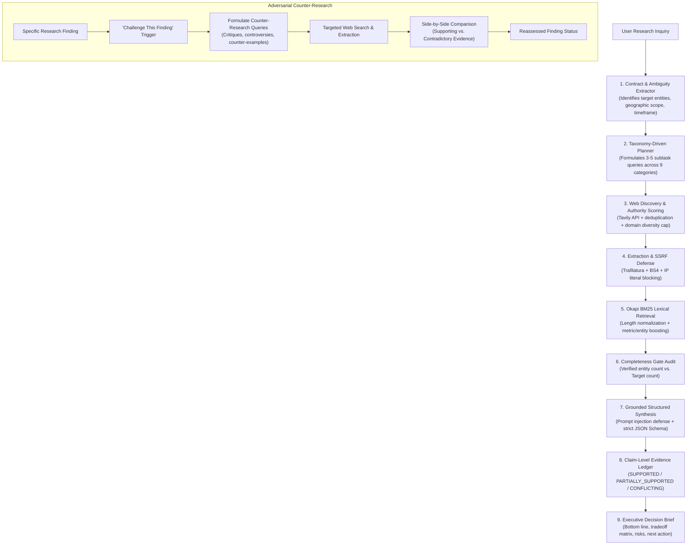

# ResearchPilot AI

> **An Evidence-First AI Research and Decision Intelligence Platform**  
> *"Every important conclusion is traceable, every uncertainty is visible, and every finding can be challenged."*

---

## 1. Project Overview

**ResearchPilot AI** is an autonomous research and decision-support workspace designed to conduct thorough, verifiable investigations on complex topics. Rather than behaving like an ungrounded chatbot that generates fluent prose with unverified citations, ResearchPilot implements a rigorous **Research Integrity Engine**. 

It translates user inquiries into auditable research contracts, formulates taxonomy-driven search plans, performs multi-query web discovery, strips boilerplate and advertisements, indexes extracted text with the Okapi BM25 retrieval algorithm, verifies claims against direct source excerpts, conducts adversarial counter-evidence investigations, and synthesizes structured decision briefs.

---

## 2. Problem Statement

Most AI research tools and ChatGPT wrappers suffer from fundamental flaws:
1. **Superficial Citations & Hallucinations**: Models cite URLs without verifying whether the webpage actually supports the specific claim.
2. **Confirmation Bias**: Search queries only confirm the initial hypothesis, never searching for criticisms, rebuttal data, or contrary market dynamics.
3. **Incomplete Scopes**: When asked for "the top 3 companies," agents often retrieve only 1 or 2 entities and pad the rest with generalities without acknowledging missing data.
4. **Opaque Confidence**: Users are presented with a single authoritative-sounding paragraph without visibility into source authority, evidence density, or data conflicts.
5. **Lack of Actionability**: Outputs read like academic essays rather than actionable, executive decision briefs.

---

## 3. Why ResearchPilot AI?

ResearchPilot AI is engineered from the ground up to solve these problems through its **Research Integrity Engine**:

- **Contract-Driven Completeness**: Every inquiry establishes a structured contract (target entity count, scope, horizon). If information is missing, the system flags missing entity slots rather than faking completeness.
- **Claim-Level Evidence Ledger**: Every factual conclusion is classified into one of four verification states (`SUPPORTED`, `PARTIALLY_SUPPORTED`, `CONFLICTING`, `UNVERIFIED`) and anchored to verbatim text excerpts from collected web chunks.
- **"Challenge This Finding"**: Users can challenge any finding with one click. The agent autonomously formulates adversarial counter-queries, hunts for conflicting evidence, and presents a side-by-side reassessment.
- **Audited Lexical Retrieval**: Uses Okapi BM25 with document length normalization and entity/financial metric boosting rather than opaque embeddings that hallucinate semantic similarity.
- **Security-First Architecture**: Features strict SSRF protection against private network probing and prompt-injection defense against adversarial web content.

---

## 4. Key Features

| Feature | Description | Status |
| :--- | :--- | :--- |
| **Claim-Level Evidence Ledger** | Findings are paired with verification badges (`SUPPORTED`, `CONFLICTING`, etc.), source authority scores, and verbatim excerpts. | **Implemented & Verified** |
| **"Challenge This Finding" Engine** | Interactive adversarial investigator that hunts for rebuttals, critiques, and counter-evidence to stress-test claims. | **Implemented & Verified** |
| **Research Completeness Gate** | Verifies that user-requested entity counts and criteria are fulfilled. Flags missing slots if incomplete. | **Implemented & Verified** |
| **Research Gap Analyzer** | Audits subtask coverage, flags single-source dependencies, detects unverified metrics, and suggests follow-up queries. | **Implemented & Verified** |
| **Executive Decision Brief** | Distills findings into strategic bottom lines, multi-option tradeoff matrices, risk assessments, and next practical steps. | **Implemented & Verified** |
| **Groq Model Availability Preflight** | Verifies accessible Groq models upon startup (`openai/gpt-oss-120b`, fallback `openai/gpt-oss-20b`) with exponential backoff. | **Implemented & Verified** |
| **Okapi BM25 Ranking** | Custom lexical retrieval ($k_1=1.5, b=0.75$) with length normalization and entity/financial metric boosting. | **Implemented & Verified** |
| **Dual Interface (React + Streamlit)** | Full-stack React 19 + TypeScript + Tailwind SaaS workspace with real-time SSE streaming, plus a classic Streamlit UI. | **Implemented & Verified** |
| **Multi-Format Export** | Export comprehensive research dossiers as Clean Markdown (`.md`), Structured JSON (`.json`), or Comparison CSV (`.csv`). | **Implemented & Verified** |

---

## 5. Research Workflow & Architecture



---

## 6. Technology Stack

- **Backend Framework**: Python 3.13, [FastAPI](https://fastapi.tiangolo.com/), [Uvicorn](https://www.uvicorn.org/), [SSE-Starlette](https://github.com/sysid/sse-starlette) (Server-Sent Events)
- **Frontend SPA**: React 19, TypeScript, [Vite 6](https://vite.dev/), [Tailwind CSS](https://tailwindcss.com/), [Lucide React](https://lucide.dev/)
- **Fallback UI**: [Streamlit](https://streamlit.io/)
- **LLM Provider**: [Groq SDK](https://github.com/groq/groq-python) (Default: `openai/gpt-oss-120b`, Fallback: `openai/gpt-oss-20b`)
- **Web Discovery**: [Tavily Search API](https://tavily.com/)
- **Content Extraction**: [Trafilatura](https://trafilatura.readthedocs.io/) + [BeautifulSoup4](https://www.crummy.com/software/BeautifulSoup/)
- **Lexical Retrieval Engine**: Custom Okapi BM25 implementation (`core/retrieval.py`)
- **Data Validation & Schemas**: [Pydantic v2](https://docs.pydantic.dev/)
- **Database**: SQLite3 (`research_history.db`) for persistent run snapshots and challenge audits
- **Testing & Benchmarks**: [Pytest](https://docs.pytest.org/), custom offline evaluation suite (`evaluation/run_evaluation.py`)

---

## 7. Project Directory Structure

```text
ResearchPilot-AI/
├── .env.example                 # Sanitized environment variable template
├── .gitignore                   # Comprehensive ignore rules (secrets, venvs, databases)
├── README.md                    # Project documentation and architectural guide
├── requirements.txt             # Python production dependencies
├── requirements-dev.txt         # Development and testing dependencies
├── main.py                      # Autonomous research CLI entrypoint
├── orchestrator.py              # Research Integrity Engine orchestrator
├── app.py                       # Classic Streamlit application fallback
│
├── api/                         # FastAPI Backend & SSE Streaming Layer
│   ├── __init__.py
│   └── main.py                  # API endpoints, SSE stream generator, static file server
│
├── core/                        # Core Engine Modules
│   ├── __init__.py
│   ├── config.py                # Environment configuration loader with safe fallbacks
│   ├── llm.py                   # Groq provider abstraction with model preflight & retries
│   ├── schemas.py               # Pydantic v2 data models for contracts, claims, & reports
│   ├── completeness.py          # Research contract extraction and completeness auditing
│   ├── retrieval.py             # Okapi BM25 ranking algorithm and text chunking
│   ├── evidence.py              # Claim verification auditing and confidence metrics
│   ├── gap_analyzer.py          # Research coverage matrix and single-source risk audit
│   └── storage.py               # SQLite storage for research runs and challenge audits
│
├── agents/                      # Specialized AI Agents
│   ├── __init__.py
│   ├── planner.py               # Taxonomy-driven research planner (9 domains)
│   ├── synthesizer.py           # Grounded report synthesizer with prompt-injection defense
│   ├── challenger.py            # Adversarial counter-evidence investigator
│   └── decision_brief.py        # Executive decision brief generator
│
├── tools/                       # Hardened External Tools
│   ├── __init__.py
│   ├── web_search.py            # Tavily search wrapper with authority scoring & diversity
│   └── page_reader.py           # SSRF-protected webpage extractor (Trafilatura + BS4)
│
├── frontend/                    # Modern React 19 + TypeScript + Tailwind SPA
│   ├── index.html
│   ├── package.json
│   ├── tsconfig.json
│   ├── vite.config.ts
│   ├── tailwind.config.js
│   └── src/
│       ├── App.tsx              # Main application controller
│       ├── main.tsx             # React entry point
│       ├── types.ts             # TypeScript interfaces matching backend Pydantic models
│       ├── api.ts               # API client and Server-Sent Events subscriber
│       └── components/          # Reusable UI components
│           ├── Header.tsx       # App header with live model & engine health status
│           ├── HomeScreen.tsx   # Inquiry input, verified benchmark scenarios, history
│           ├── InvestigationWorkspace.tsx # Real-time 5-stage SSE execution timeline
│           ├── FindingCard.tsx  # Verifiable claim card with "Challenge this finding"
│           ├── ChallengeModal.tsx # Side-by-side adversarial counter-evidence drawer
│           ├── CompletenessGateView.tsx # Contract fulfillment & missing entity slots
│           ├── ResearchGapView.tsx      # Subtask coverage matrix & gap query dispatcher
│           ├── DecisionBriefView.tsx    # Strategic bottom line & decision tradeoff matrix
│           ├── EvidenceGraphView.tsx    # Lineage visualization from inquiry to chunks
│           ├── SourceExplorer.tsx       # Filterable source authority ledger
│           └── ReportWorkspace.tsx      # Tabbed report workspace
│
├── tests/                       # Deterministic Test Suite
│   ├── test_citations.py        # Validates claim-level citation grounding
│   ├── test_model_preflight.py  # Tests Groq model verification and fallback logic
│   ├── test_planner_intelligence.py # Tests category classification and ambiguity detection
│   ├── test_retrieval.py        # Validates Okapi BM25 scoring and metric boosting
│   ├── test_safety_and_failures.py  # SSRF protection and prompt-injection tests
│   └── test_source_quality.py   # Authority scoring and canonical URL deduplication
│
└── evaluation/                  # Benchmark Evaluation Suite
    ├── test_queries.json        # 10 scenario benchmarks covering diverse research domains
    ├── run_evaluation.py        # Evaluation harness for deterministic & live test runs
    └── evaluation_results.json  # Stored benchmark test results
```

---

## 8. Installation Instructions

### Prerequisites
- **Python**: Version 3.10, 3.11, 3.12, or 3.13
- **Node.js**: Version 18.0.0 or higher
- **Package Manager**: `npm` (included with Node.js)

### Step 1: Clone Repository
```bash
git clone https://github.com/Lakhank123/Research-Agent.git
cd Research-Agent
```

### Step 2: Python Environment Setup
```bash
# Create virtual environment
python -m venv .venv

# Activate on Windows (Command Prompt / PowerShell):
.venv\Scripts\activate
# Activate on macOS / Linux:
source .venv/bin/activate

# Install Python backend dependencies
pip install -r requirements.txt -r requirements-dev.txt
```

### Step 3: Frontend Setup
```bash
cd frontend
npm install
cd ..
```

---

## 9. Environment Variable Configuration

Create a `.env` file in the root directory by copying `.env.example`:

```bash
cp .env.example .env
```

Configure your API credentials in `.env`:

```env
# Groq API Configuration
GROQ_API_KEY=gsk_your_groq_api_key_here
GROQ_MODEL=openai/gpt-oss-120b
GROQ_FALLBACK_MODEL=openai/gpt-oss-20b

# Tavily Search API Configuration
TAVILY_API_KEY=tvly-your_tavily_api_key_here

# Research Pipeline Parameters
MAX_SEARCH_QUERIES=5
MAX_SOURCES=8
MAX_CHUNKS_IN_CONTEXT=14
REQUEST_TIMEOUT_SECONDS=15
MAX_RESEARCH_PASSES=2
```

> **Security Guarantee:** `.env` and `research_history.db` are strictly listed in `.gitignore` and are never committed to version control.

---

## 10. Backend Startup Instructions

Start the FastAPI backend server with Uvicorn:

```bash
# Windows (PowerShell):
.\.venv\Scripts\python.exe -m uvicorn api.main:app --port 8000 --host 0.0.0.0

# macOS / Linux:
python -m uvicorn api.main:app --port 8000 --host 0.0.0.0
```

- **API Base URL**: `http://localhost:8000`
- **Interactive Swagger Documentation**: `http://localhost:8000/docs`
- **Health Endpoint**: `http://localhost:8000/api/health`

---

## 11. Frontend Startup Instructions

Start the React development server:

```bash
cd frontend
npm run dev -- --port 5173
```

- **React SaaS Workspace**: `http://localhost:5173`

*(Note: The FastAPI backend also serves the pre-built React production bundle directly at `http://localhost:8000/` when built).*

### Classic Streamlit Interface (Alternative)
If you prefer the original Streamlit interface, start it using:

```bash
streamlit run app.py --server.port 8501
```
- **Streamlit URL**: `http://localhost:8501`

---

## 12. How to Use the Application

1. **Launch the Workspace**: Navigate to `http://localhost:5173` in your browser.
2. **Select Research Depth**:
   - `Quick`: Rapid 2-pass search for fast summaries.
   - `Standard`: Default comprehensive research pass with Okapi BM25 indexing.
   - `Deep`: Exhaustive multi-query investigation with entity verification.
3. **Submit an Inquiry**: Enter your question or select from the pre-configured benchmark cards.
4. **Live Pipeline Execution**: Follow real-time Server-Sent Events (SSE) across 5 stages:
   - *Stage 1: Intent & Contract Planning*
   - *Stage 2: Web Discovery & Quality Scoring*
   - *Stage 3: Full Page Extraction & SSRF Filtering*
   - *Stage 4: BM25 Lexical Ranking & Ledger Building*
   - *Stage 5: Grounded Synthesis & Decision Brief*
5. **Inspect Claim Verification**: Expand finding cards to view verification status badges (`SUPPORTED`, `CONFLICTING`) and verbatim text excerpts from actual web chunks.
6. **"Challenge This Finding"**: Click the challenge button on any finding to run live counter-research and inspect contradictory evidence.
7. **Export Dossier**: Use the top-right export button to download the report as Markdown (`.md`), JSON (`.json`), or Comparison CSV (`.csv`).

---

## 13. Example Research Queries

Try these queries to observe the system's specialized handling:

- **Entity Comparison & Completeness Gate**:
  > *"Compare the top 3 open-source vector databases (Milvus, Qdrant, Chroma) by search latency, memory footprint, and horizontal scalability."*
- **Financial & Market Analysis**:
  > *"Analyze NVIDIA's data center revenue trajectory in 2024–2025, detailing GPU architecture adoption, gross margins, and hyperscaler concentration risks."*
- **Ambiguity Resolution**:
  > *"Find the three most profitable businesses in India."*  
  *(Observe how the planner detects ambiguity, defines working definitions between public corporations and SME sectors, and executes balanced queries).*
- **Technology & Architecture Evaluation**:
  > *"Compare Server-Sent Events vs. WebSockets for real-time generative AI streaming in production SaaS applications."*

---

## 14. Testing and Evaluation

### Automated Unit Test Suite
The repository includes 13 deterministic pytest unit tests covering critical algorithmic paths without incurring API costs:

```bash
pytest tests/ -v
```

Test coverage includes:
- `tests/test_citations.py`: Citation ID validation and grounded excerpt verification.
- `tests/test_model_preflight.py`: Groq model availability preflight and fallback selection.
- `tests/test_planner_intelligence.py`: Taxonomy classification and ambiguity detection.
- `tests/test_retrieval.py`: Okapi BM25 lexical ranking, length normalization, and term boosting.
- `tests/test_safety_and_failures.py`: SSRF rejection of private IP ranges and prompt-injection sanitization.
- `tests/test_source_quality.py`: Domain authority scoring, freshness bonuses, and URL deduplication.

### Benchmark Evaluation Suite
Run the evaluation suite against 10 standardized scenarios:

```bash
# Run deterministic offline fixture tests (tool failures & prompt injection handling):
python evaluation/run_evaluation.py

# Run full live evaluation against external APIs (requires active keys):
python evaluation/run_evaluation.py --live
```

---

## 15. Limitations and Future Improvements

### Current Limitations
- **External Rate Limits**: High-depth research runs make multiple concurrent calls to Groq and Tavily, which can be constrained by free-tier rate limits.
- **Paywalled Content**: Content behind strict anti-bot systems or paywalls cannot be scraped; the agent flags these as unretrievable sources and seeks alternative domains.
- **Dynamic Single-Page Apps**: Pages that rely entirely on heavy client-side JavaScript rendering may yield sparse text with Trafilatura.

### Planned Enhancements
- **Tree-of-Thought Subagent Exploration**: Spawning asynchronous child investigators for complex multi-faceted research paths.
- **Local Embedding Fallback**: Hybrid search combining Okapi BM25 with local, zero-cost ONNX vector embeddings.
- **PDF & Document Parsing**: Direct file ingestion for proprietary financial filings (10-K, 10-Q) and scientific preprints.

---

## 16. License

This project is licensed under the MIT License — see the [LICENSE](LICENSE) file for details.
